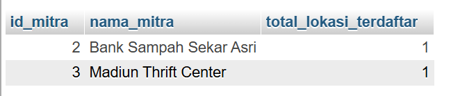

**1. Eksplorasi JOIN (Tahap 1): Tulis dan eksekusi satu query yang menggunakan JOIN (minimal 2 tabel)
     dikombinasikan dengan fungsi agregasi (misal: menghitung total transaksi per pelanggan atau total barang terjual).           Catat kompleksitas query-nya.**

Jawab:

 ```sql
 -- 1.Menghitung total tempat/lokasi ramah lingkungan yang didaftarkan oleh setiap mitra
SELECT 
    u.user_id AS id_mitra,
    u.name AS nama_mitra,
    COUNT(l.lokasi_id) AS total_lokasi_terdaftar
FROM users u
JOIN lokasi l ON u.user_id = l.mitra_id
WHERE u.role = 'mitra'
GROUP BY u.user_id, u.name;
```



Analisis Kompleksitas Query:
Kompleksitas Waktu (Time Complexity): Secara teoretis, kompleksitas kueri ini berada pada kisaran O(N×M) atau O(N log⁡ N ) jika dioptimalkan dengan indeks.  

-Mesin database harus melakukan pemindaian atau pencocokan baris (join) antara tabel users (N baris) dan tabel lokasi (M      baris) melalui kolom relasi foreign key (mitra_id).
-Proses filter WHERE u.role = 'mitra' membantu mempersempit baris awal dari tabel users sebelum dicocokkan.
-Fungsi agregasi COUNT() dan pengelompokan GROUP BY memerlukan tahapan tambahan berupa penyortiran atau pengelompokan data akhir berdasarkan ID mitra.  

Kompleksitas Ruang (Space Complexity):O(K), di mana K adalah jumlah baris unik mitra yang lolos dari filter dan berhasil dikelompokkan pada tabel hasil sementara (temporary result set).

---
